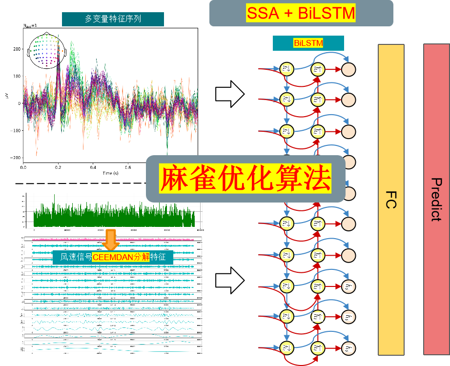
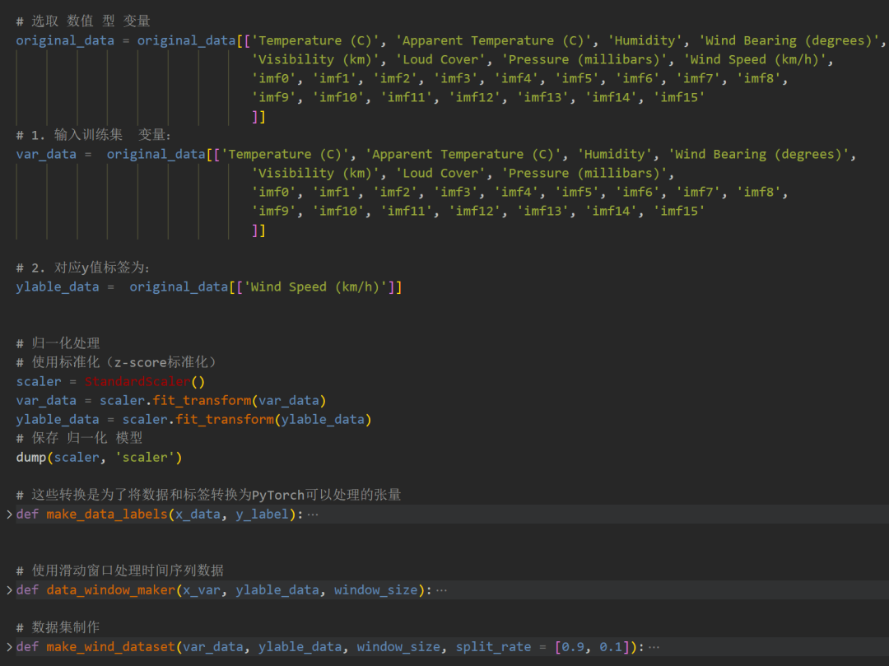
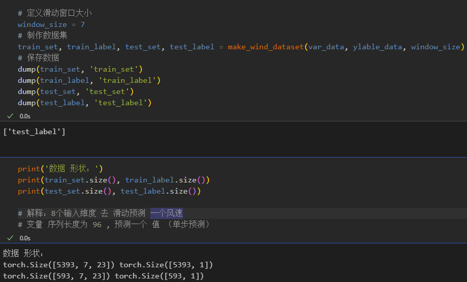
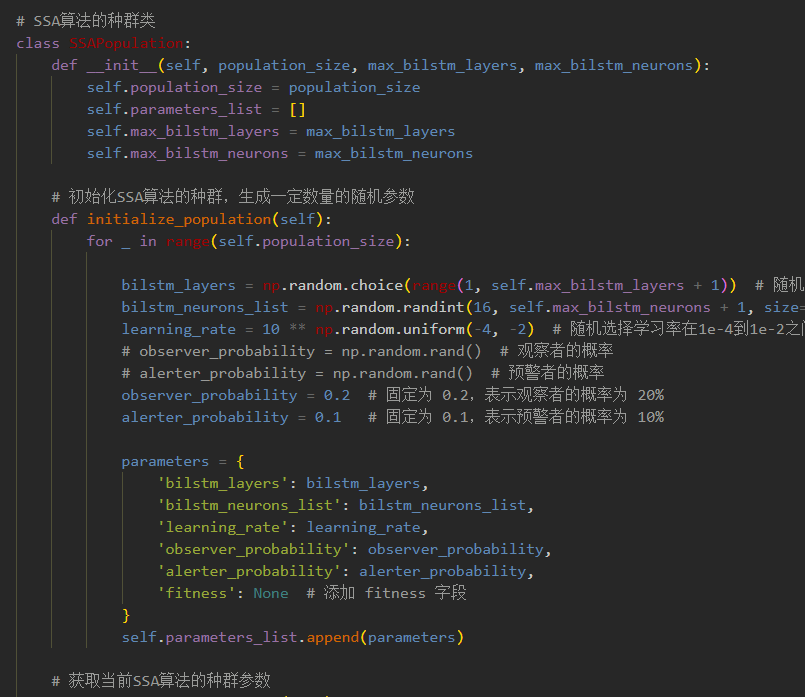
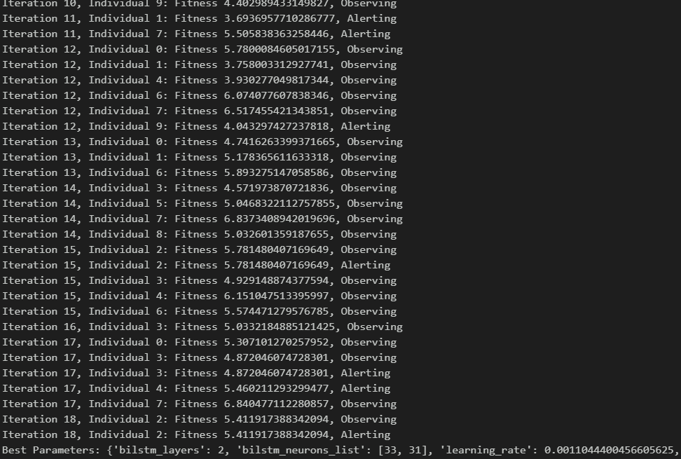
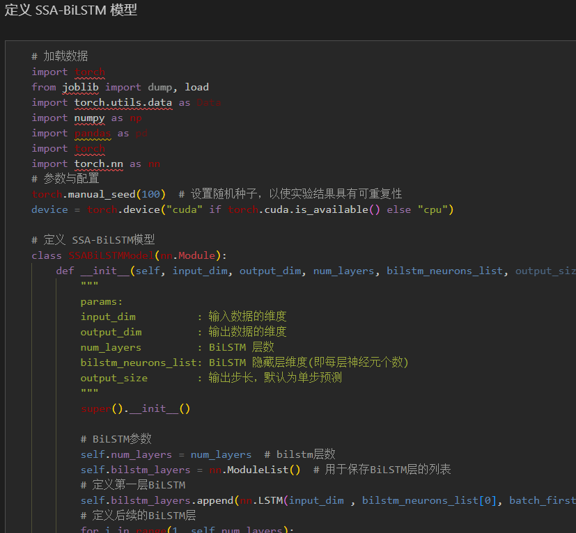
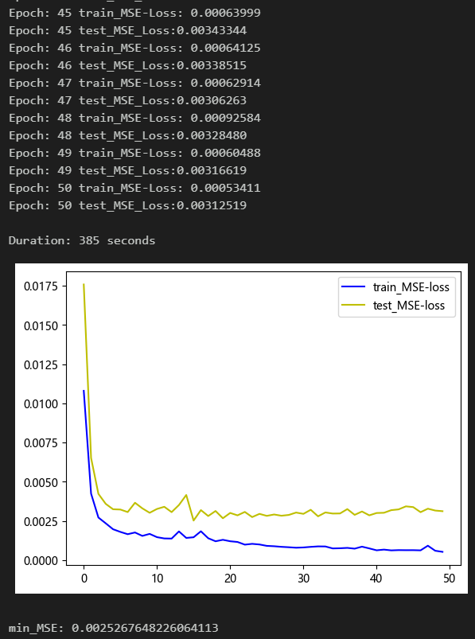
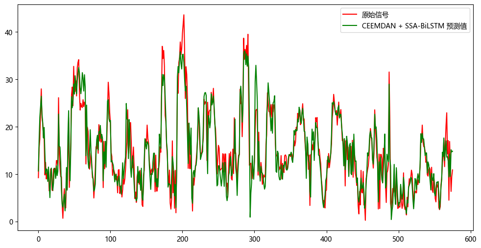
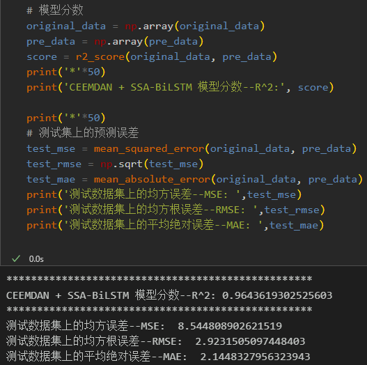
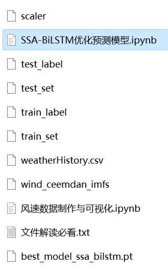

# Multi-Feature Variable Sequence Prediction (8) CEEMDAN-SSA-BiLSTM Prediction Model Based on Sparrow Optimization Algorithm

Including wind speed data, as well as the already generated and prepared wind speed dataset and label set, corresponding codes can be run.
The CEEMDAN+SSA-BiLSTM model has achieved smaller MSE and MAE, showing particularly significant improvements in performance!
Includes data preprocessing code, CEEMDAN decomposition code, and complete CEEMDAN+SSA-BiLSTM model prediction and visualization code.
Environment: Python 3.9, Pytorch 1.8 and above.
Preface
This paper introduces a comprehensive application of the Complete Ensemble Empirical Mode Decomposition (CEEMDAN) and the Sequential Speech-to-Text Model with Bird's Nest Optimization Algorithm (SSA-BiLSTM) for multi-feature variable sequence prediction models, aiming to enhance the predictive performance of time series data.
The overall structure of the model: The dataset consists of nine variables, including weather, temperature, humidity, pressure, and wind speed. The CEEMDAN algorithm is used to decompose the wind speed sequence, and then all components are combined with the original dataset variables to form an enhanced feature input. A sliding window is created to create the dataset, and multivariate prediction is performed using this dataset. The SSA-BiLSTM model is optimized by the Sparrow Optimization Algorithm, which extracts the enhanced features and then feeds them into a fully connected layer to achieve a high-precision predictive model.
The detailed introduction to the wind speed dataset can be found in the following text:
Wind Speed Prediction (Part 1) Data Set Introduction and Preprocessing
\t  
1. Dataset Preparation and Preprocessing for Multi-Feature Variables
1.1 Import data
1.2 CEEMDAN Decomposition
\t  
1.3 Dataset Preparation and Preprocessing
\tFirstly, merge the original data variables and decomposed components, and then divide the training set and test set according to a ratio of 9:1.
\t\tCreating dataset
3. Sparrow Optimization Algorithm
\t3.1 Introduction to the Sparrow Optimization Algorithm
Sparrow Optimization Algorithm (SOA) is an optimization algorithm based on the characteristics of bird behavior in nature. It simulates the optimization strategies of birds in foraging, migration, and social interactions. The SOA has shown good performance in solving various optimization problems.
The basic idea of the Sparrow Optimization Algorithm is to continuously optimize solutions in the search space by simulating the foraging behavior of birds. The process can be divided into three stages: foraging behavior, migration behavior, and social behavior.
1. Foraging Behavior: When searching for food, birds choose food sources that are closer and have higher fitness values. In the algorithm, each individual in the solution space is considered a food source with a fitness evaluation value. Birds select individuals with higher fitness values to find better solutions.
2. Migration Behavior: If birds do not find a better solution after searching around a food source for a certain period, they will choose to leave the current food source and move to other food sources to continue searching. In the algorithm, the position information between individuals will change to simulate the migration behavior of birds.
3. Social Behavior: When birds are foraging, they communicate with other birds to obtain more information and improve their foraging efficiency. In the algorithm, individuals exchange information to improve their solutions and update the optimal solution in the solution space.
\t3.2 Implementation of Sparrow Optimization Algorithm Based on Python
\t3.3 Superparameter Optimization Process of Sparrow Optimization Algorithm
The Sparrow Optimization Algorithm has the characteristics of simplicity, easy implementation, global optimization capability, and self-adaptability, making it suitable for solving combinatorial optimization problems. We use the Sparrow Optimization Algorithm to perform superparameter optimization for the SSA-BiLSTM model.
By setting the appropriate population size and number of optimization iterations, we search for the optimal parameters within the given hyperparameters range.
3. Prediction Model Based on Pytorch's CEEMDAN + SSA-BiLSTM
3.1 Definition of the CEEMDAN + SSA-BiLSTM prediction model
Note: The input wind speed data shape is [64, 7, 23], batch_size=64, where 7 represents the sequence length (the sliding window takes values), and the dimension 23 represents the dimensions of the selected 8 variables and 15 components.

3.2 Set parameters and train the model
Training for 50 epochs, MSE is 0.002526. The multivariate feature CEEMDAN + SSA-BiLSTM prediction effect is good. After adding the CEEMDAN decomposition, the multivariate prediction effect has been significantly improved, with superior performance. By appropriately adjusting the model parameters, further improvement in model prediction performance can be achieved.
Note to adjust parameters:
- Modify the population size and optimization iteration times of the bird algorithm;
- Adjust the parameter search range for the number of layers and dimensions per layer of the BiLSTM, increase more epochs (note to prevent overfitting);
- Change the sliding window length (set a suitable window length).

4. Model Evaluation and Visualization
4.1 Results Visualization
4.2 Model Evaluation

## Images

<!-- PAYMENT_BLOCK -->

## Get this dataset

- Payment link (Stripe): [Buy now](https://buy.stripe.com/3cs8yP7sY87d0vu9AB)
- Payment QR code: 

<!-- /PAYMENT_BLOCK -->
